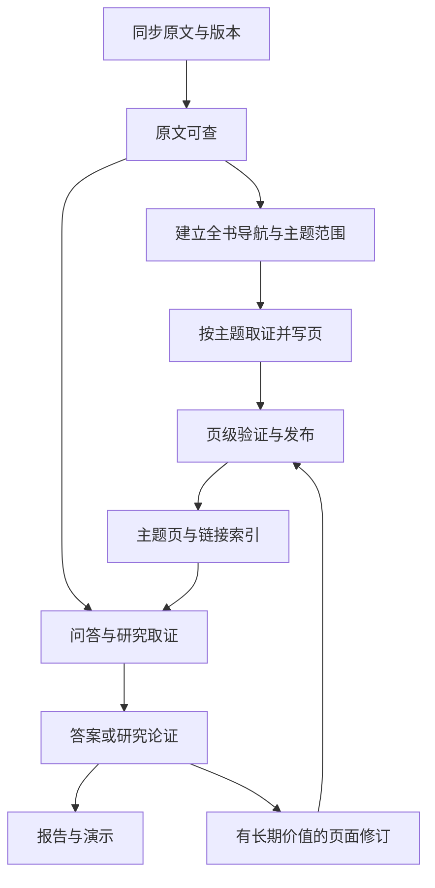

# 书籍知识库重构方案

2026-11-15 修订，替代上一版渐进改造方案。当前实现基线为 `main` 的 `3ed7210`。建议为 Book Wiki 新建一条以主题页为核心的知识链路。**编译交付可连读、可持续修订的 Wiki，问答用 Wiki 理解问题并回原文查证，研究交付一份有主线的报告。** 首个里程碑以真实阅读和回答质量为准。 [当前需求](../requirement/08-llm-wiki.md) · [当前开发设计](08-llm-wiki.md)

2026-11-17 复核。上一轮 `deepinfer-book` 通过了全库编译、发布和引文定位的技术检查。真实产物有 27 份已索引文档、9 篇已发布主题、17 份有正文引用的文档。395 个小节中有 24 个不同小节进入正文引用，9 篇主题之间有 0 条阅读链接。验收缺少主题导航、关联质量、旧页更新和语义体检。[正式入口与迁移](08-llm-wiki.md#7-全库主题编译)

### 与 Karpathy 原文的差距

- **原文和主题修订已经分离。** 原文通过不可变版本追溯。主题页有独立的草稿、发布和历史。SQLite 保存修订，Markdown 导出承载可移植的阅读产物。
- **页间关联和维护规则是成品的一部分。** 旧成品只有阅读顺序和来源编号。旧规划只看近期标题，写页时缺少相邻页的职责和关联理由。Karpathy 的三层模型要求原文、持久的相互链接 Wiki、可共同修订的维护规则，并在摄入、查询与体检中反复使用它们。[Karpathy 原文](https://gist.github.com/karpathy/442a6bf555914893e9891c11519de94f)
- **应先定位需要编辑的旧内容。** `josephmqiu/karpathy-llm-wiki-template` 在摄入时做哈希检查、寻找同义名称和受影响的旧页，同步维护索引、日志与摄入登记。`Fize/karpathy-llm-wiki` 对材料分别决定新增、更新、争议和无实质增量，然后检查连带影响。整书批量启动沿用本产品流程，去重、复用旧页和记录归属仍需发生在内部。[摄入流程](https://github.com/josephmqiu/karpathy-llm-wiki-template/blob/main/skills/ingest/SKILL.md) · [Fize Skill](https://github.com/Fize/karpathy-llm-wiki/blob/main/SKILL.md)
- **验证要有结构检查和编辑判断。** Fize 的脚本从关联原文中查找有辨识度的数字、日期、引文，输出可疑点。Joseph 的结构检查和模型语义检查各有职责。`lewislulu/llm-wiki-skill` 把读者对某页的反馈及处理结果存进维护流程。[证据检测脚本](https://github.com/Fize/karpathy-llm-wiki/blob/main/scripts/check_evidence.py) · [两层体检](https://github.com/josephmqiu/karpathy-llm-wiki-template/blob/main/skills/lint/SKILL.md) · [读者反馈流程](https://github.com/lewislulu/llm-wiki-skill/blob/main/llm-wiki/SKILL.md)

### 这次实现与后续验收

共享编辑规则进入规划、写页与问答。规划读取当前主题页的范围和正文开头，支持沿用已有页身份，向写页任务提供经过校验的阅读关系。缺少关联的多主题方案需要给出内容独立的理由。规划失败时保留索引及已发布页，留待继续处理。写稿在调用模型前检查能否取到所有分配的正文。

主题修订保存关联页和阅读理由，发布后用同书有效页面生成正向链接、反链和可移植的 Markdown 相对链接。应用从真实发布版本构建导览、带摘要的主题索引和维护日志，体检列出孤立主题、来源过期和等待目标页发布的关系。已发布旧稿通过升级保留，历史关系显示以出版记录为准。

实际模型验收需要同时看到以下结果。

1. **首次编译。** 从全书材料形成导览与有独立问题的主题。随机抽读跨章的三条阅读路径和五项高风险结论。记录每份材料进入哪个主题、仅能查询原文或读取失败的原因。
2. **来源更新。** 修改一个影响两个主题的条件，核对原地修订、出处变化、其他主题修订编号及模型调用次数。编译已保存来源版本和主题分配，后续用变化段落、已有正文和直接引用定位受影响的页。已生成的无关页复用原修订，来源处置和复用情况进入维护日志。 [实现细节](08-llm-wiki.md#增量维护)
3. **问答积累。** 用跨主题、比较和反例题核对主题召回及已读原文。可从问答或已核验报告选择段落，携带证据写入已有页的草稿。隔离测试覆盖草稿编辑、引用区间预览、显式发布及过期材料校验。
4. **语义体检。** 已发布页的醒目数字和引语与其历史出处对照。模型抽查主题间的条件或结论差异，返回能定位到两处页面原句的问题。模拟验收覆盖无依据数字、冲突摘录以及来源变化后的复核状态。

在 `deepinfer-book` 的隔离副本上，用真实模型同步了全部 27 份文档，发布 12 篇主题和 34 条阅读关联，正文用到 19 份文档。全书冷编译约 9 分钟，恢复了 1 次规划超时和 4 次写页超时。两道跨章问答的关键数字和条件与原文一致。重复编译同一快照约 4 秒，复用 12 篇，模型调用为零。改动一章后约 4 分钟，6 次模型调用，修订 4 篇并复用 8 篇，4 篇中有 2 篇直接依赖该章。

## 1. 从用户要读到什么倒推架构

用户打开一本已编译的书，应先看到全书在解释哪些问题、几个核心主题如何关联、深入某个主题应该沿什么路径阅读。一页要讲清一个值得独立阅读的问题，合并分散在定义、机制、实验和反例中的材料。术语可以在页内解释并用于搜索。原文中的细节仍能直接查证。

重构前的编译器对跨批主题安排两轮写作。来源批次必须返回目录摘要、完整 Markdown、原子论断、引用和关系。主题跨批或匹配到旧条目后，又须为整个主题生成正文，并回报全部保留论断的索引。旧版资源分配也明确为正文和论断的重复表达预留输出。这一机制让模型先在局部批次里决定页面粒度，然后逐主题补救全书组织。

仓库的真实模型验收显示，修正输出预算和供应商参数后，八篇夹具完成一轮编译，输出 8 个主题、53 条论断引用，条目组织仍接近章节，别名部分留在独立术语页。后续一次来源更新约 102 秒后因归并缺少保留论断索引而失败。决策报告的主要事实核对通过，编辑审阅却发现多个主题与综合重复基准与门槛，个别限定被改写成绝对结论。这些是隔离夹具记录。新版质量需要用未参与设计的书和任务单独验证。 [初轮验收](2026-10-02-wiki-acceptance-results.md#5-真实编译失败证据与修复后结果) · [归并与报告复测](2026-10-03-wiki-acceptance-closeout-results.md#5-r2p1决策研究与真实下载) · [来源刷新失败](2026-10-03-wiki-acceptance-closeout-results.md#7-w2旧版快照真实刷新与无依赖成果复用)

| 需要重做的部分 | 新流程中的交付物 |
| --- | --- |
| 批次实体抽取、逐主题归并、全书变更集 | 全书导航和少量主题页。新增来源产生页内修订、少量新页或无实质改动。每个相互独立的页面修订可以单独发布。 |
| 模型扫描条目目录后选证据 | 主题页与原文分别检索。页内上下文解释机制和条件，原文片段支撑精确事实，必要时主动补反例。 |
| 每个子问题生成完整章节，最后拼接综合 | 子问题产出简短取证笔记。一个作者负责大纲、主线和报告正文，成稿按论证和证据验收。 |
| 从整篇 Markdown 报告直接策划 PPT | 报告和演示共享证据与核心判断。听众、场合和时间决定演示独立的提纲与分页。 |

建议新路径以主题页作为知识的写入和阅读单位，沿用应用的书籍身份、来源快照、原文定位和 SQLite 事务。SQLite 保存主题页 Markdown 的正文、出处与修订。目录、别名搜索、反链和按需绘制的关系视图从这些页面重建，Markdown 导出提供可浏览的专题页和来源链接。首版采用每书隔离、Markdown 文件夹和显式授权外部取证。 [当前存储约定](../requirement/08-llm-wiki.md#81-唯一事实来源) · [现有 Markdown 导出](../../backend/src/core/book_wiki_export.rs#L373)

## 2. 开源实现改变了哪些设计决定

参考项目把编辑、搜索和写作的边界放在了不同位置。新方案选择相应的工作单位和验证方法。

| 参考实现 | 实际做法 | 对这个项目的设计决定 |
| --- | --- | --- |
| Karpathy 的 LLM Wiki 与 Karpathy LLM Wiki Template | 原文把原始来源、持续修订的 Wiki 和维护规则分开。模板摄入时先查来源哈希，优先补现有页面，更新主题导航、索引和日志。查询从导航进入具体页面，值得复用的综合可以归档。结构检查由脚本处理，语义体检围绕共享来源和反链展开。 | 编译从书的问题和主题导航出发。新增来源优先更新现有页。来源登记、页面索引和维护日志由应用写，模型负责编辑知识。持久化单位是来源版本及其影响的页面修订。 [Karpathy 原文](https://gist.github.com/karpathy/442a6bf555914893e9891c11519de94f) · [摄入规则](https://github.com/josephmqiu/karpathy-llm-wiki-template/blob/main/skills/ingest/SKILL.md) · [查询规则](https://github.com/josephmqiu/karpathy-llm-wiki-template/blob/main/skills/query/SKILL.md) · [体检规则](https://github.com/josephmqiu/karpathy-llm-wiki-template/blob/main/skills/lint/SKILL.md) |
| NiharShrotri 的本地 LLM Wiki | 代码先抽取摘要、实体与概念，再解析已有 slug，按实体和概念逐页起草或更新，并生成来源说明。已有页进入编辑提示。 | 采纳稳定页面身份和局部编辑。把一次发现一个实体就触发一次写页的扇出改成先确定少量可读主题，再按主题生成。来源摘要优先用独立索引和摘要片段承载。 [摄入源码](https://github.com/NiharShrotri/llm-wiki/blob/main/src/llm_wiki/ingest_llm.py) · [问答源码](https://github.com/NiharShrotri/llm-wiki/blob/main/src/llm_wiki/query.py) |
| QMD 与 GraphRAG | QMD 的混合搜索先试词法命中，强信号时省略昂贵的查询扩写。保留原查询权重，融合候选后在命中片段上重排。GraphRAG 的本地查询结合知识图与原文，面向全库的查询读取社区报告。 | 中英文术语、代码标识和版本用词法优先。同义改写用小候选集的语义召回补足。窄题阅读页内命中小节，全书题先读导航和横向比较。已有的主题页承担综合层，无需先生成社区图。 [QMD 检索源码](https://github.com/tobi/qmd/blob/main/src/store.ts) · [GraphRAG 查询模式](https://microsoft.github.io/graphrag/query/overview/) |
| Stanford STORM 与 Open Deep Research | STORM 用预先收集的材料修订大纲，再按大纲检索写节。文章润色模块有可选的去重。Open Deep Research 把独立取证结果交给最终作者，源码有并发上限，达到上下文上限时可截短发现字符串再试。 | 研究笔记和读者正文用不同的产物。达到预算时保住关键证据、反证和缺口，按论证结构分配篇幅。短报告由一个作者一次成稿，长报告分节写作后做全文编辑。 [STORM 大纲](https://github.com/stanford-oval/storm/blob/main/knowledge_storm/storm_wiki/modules/outline_generation.py) · [STORM 分节写作](https://github.com/stanford-oval/storm/blob/main/knowledge_storm/storm_wiki/modules/article_generation.py) · [全文编辑](https://github.com/stanford-oval/storm/blob/main/knowledge_storm/storm_wiki/modules/article_polish.py) · [Open Deep Research 源码](https://github.com/langchain-ai/open_deep_research/blob/main/src/open_deep_research/deep_researcher.py) |
| PPTAgent、DeepPresenter 与 Presenton | PPTAgent 先草拟大纲后编辑每页，用内容、设计和连贯性评估。DeepPresenter 根据实际渲染做修订。Presenton 接口允许自动页数、指定页数或直接给逐页大纲。 | 用已核验论证策划演示。后端依据页面容量给出可解释的页数，对生成文件做逐页检查。 [PPTAgent 论文](https://aclanthology.org/2025.emnlp-main.728/) · [DeepPresenter](https://arxiv.org/abs/2602.22839) · [Presenton API](https://github.com/presenton/presenton) |

SQLite 中的一次页发布涵盖页面、出处、审核和历史修订，离线读取基于同一快照。Markdown 导出从这一版本生成，用户可以直接阅读或交给其他工具。 [当前离线投影](../../backend/src/api/handlers/offline.rs#L926) · [当前知识模型](../../backend/migrations/012_book_wiki.sql#L110)

## 3. 一份新 Wiki 应该是什么样

以仓库八篇虚构的「北辰 Cache」材料为例，可以形成一张全书导航、三个主体页面和一份书内决策综合。这个页面数只用于示例。页面是否单列取决于它能否回答独立问题、是否有稳定的证据，以及读者是否会独立查阅它。 [夹具目录](../superpowers/fixtures/wiki-acceptance/README.md)

| 页面 | 读者可以在这里弄清什么 |
| --- | --- |
| 全书导航 | 缓存从哪里获得收益。空间淘汰和读取时效各自负责什么。应从哪个概念、实验或决策开始读。 |
| 缓存载荷、容量与进程内存 | 完整的 `B = 2 L H D T b`、变量定义、16/32 MiB 算例、进程内存边界，以及容量对复用的影响。 |
| TTL、读路径与刷新 | 过期检查和后台清扫各自的职责，v1.0 与 v1.1 的默认值、适用范围和显式配置，TTL 缩短的证据缺口。 |
| 淘汰策略在不同负载下的取舍 | LRU/CLOCK 机制、别名、同口径基准、扫描反例、现有证据可支持的结论。 |
| 热点服务的灰度验证 | 书中的候选选择、共同条件、门槛、验证数据与撤回条件，连接策略和时效两页。 |

页面元数据包括稳定 `page_id`、标题、用途、可检索别名、修订及出处。正文按主题选择段落、表格、算例和反例。精确数据、版本差异和强判断旁放可点击的原文范围。简单术语归入页内解释。同一个主题后来有了新的案例或适用条件，可以在原页按阅读顺序补充。只有读者会独立查阅且已有足够依据的内容才单独建页。下例为手工样稿，用来定义产品预期。

### 示例主题页 · 淘汰策略在不同负载下的取舍

北辰 Cache 的 LRU（最近最少使用）记录完整的访问顺序。本书的四线程实现中，命中也要持有共享锁更新顺序。CLOCK（时钟策略、二次机会淘汰）在访问时置引用位，淘汰扫描时清位并继续寻找候选项。比较时要观测 LRU 的命中更新开销和 CLOCK 的扫描开销。热点重复访问且锁竞争明显时，CLOCK 值得优先验证。 [淘汰机制与适用条件](../superpowers/fixtures/wiki-acceptance/sources/03-淘汰策略.md#L3) · [术语对应](../superpowers/fixtures/wiki-acceptance/sources/07-术语对应.md#L3)

在 v1.1、四线程、2 MiB、同一 CPU、十万次请求、显式 TTL=60 秒的受控实验中，两种策略随负载呈现不同的结果。 [实验口径与原表](../superpowers/fixtures/wiki-acceptance/sources/05-受控基准.md#L3)

| 负载 | LRU 平均延迟及命中率 | CLOCK 平均延迟及命中率 |
| --- | --- | --- |
| 80% 请求集中于 100 个热点键 | 2.4 ms，92% | 1.8 ms，90% |
| 一次性顺序扫描 | 4.0 ms，3% | 4.1 ms，3% |

热点下 CLOCK 平均延迟低 25%，但命中率较低。该结果支持在热点场景把 CLOCK 纳入候选，实验未测得 P95/P99，也无法衡量默认 TTL 变化的效果。顺序扫描超过缓存容量时，两种策略都接近未命中路径，突发访问还可能增加 CLOCK 的扫描长度。选择策略时应同时考虑负载与指标。需要作上线判断时，沿导航去读「热点服务的灰度验证」中的门槛和撤回条件。 [受控基准结论](../superpowers/fixtures/wiki-acceptance/sources/05-受控基准.md#L12) · [失败边界](../superpowers/fixtures/wiki-acceptance/sources/06-反例与失败.md#L3) · [上线决策](../superpowers/fixtures/wiki-acceptance/sources/08-上线决策.md#L3)

## 4. 重写编译器

编译以**书级导航、页级写作、页级发布**为主流程。原文同步先独立完成并建立可检索的版本快照。同步后即可查证，后台慢慢形成全书导航和主题。生成失败时，读者仍可以查原文、读已发布的页面，并看到哪些主题待补。

### 4.1 首次编译

1. **给书建一张主题地图。** 输入为书名、章节标题树、原文目录、可代表不同章节的片段和少量核心材料。若整书可在经验证的输入预算内完整传入，可直接读全文建图。大书先用程序提取标题、定义、表格和交叉引用，主题规划为每页给出范围和候选来源。出现无法归属的新材料时再补主题。先提供程序生成的目录和原文入口。已核验的主题页逐步进入导航，概览段在关键页可读后补齐，并持续标出进行中的主题。
2. **按主题找原文并写页。** 从题目、别名和标题路径检索材料。至少为核心页覆盖适用条件、异例和跨章佐证。程序给实际读到的片段短编号，模型交一份 Markdown 主题页，在相关段落引用这些编号。服务器负责生成页面 ID、别名索引、反链和导航。相互独立的主题可并行。超长页按小节写作后统一编辑，表格、公式和代码片段保留结构。
3. **先交付读者最可能用的页面。** 最小成品包含可导航的目录和关键主题，对未覆盖章节明确标记。剩余页面由后台继续，按阅读进度、用户选择或实际查询缺口调整优先级。北辰夹具可用一次规划加四个页面任务，先写证据齐全的核心主题，决策页与其他主题建立链接。旧版曾用三次批量分析，约 86.4 秒进入审核。重构需要分别测首个可读主题和整书耗时，同时记录总 token 和重试率。 [旧版首次编译](2026-10-02-wiki-acceptance-results.md#5-真实编译失败证据与修复后结果)

大书的完整性来自**覆盖登记**。每个当前来源标明已关联主题、仅已索引、待编辑或读取失败。仅已索引意味着长尾内容仍可由原文查到。全书导航描述覆盖范围，编译进度分别报告来源索引和主题编辑。页数是可读性观察项，独立主题是否值得建页由实际信息决定。

保留每本书的 Purpose 作为编辑方向。把优先主题、读者希望看到的深度、已有可用范例和维护偏好编入简短的编辑规则。模型写作时拿到目标页职责和与本次相关的规则，应用另外维护权限、版本与引用约束。具体条目数量和图谱边数量不用于指导模型写作。

### 4.2 增量编辑与公开版本

1. **从已读来源和旧页定位影响。** 新增来源用标题、别名及主题描述选出候选页。修改、移动、删除来源时同时访问出处反向记录。对与现有主题高度相关的材料，先尝试补节、更新表格或补一个边界段。用于消歧的模型输出只需 `update`、`new`、`no_change` 和简短理由。更改书籍用途或编译规则时，按主题重新评估覆盖。
2. **在更新范围内写作。** 每次写作读取目标页当前修订与新旧相关原文，返回独立新页或完整小节。服务器按当前标题树提供已存在的节 ID，对新小节分配稳定 ID。输出只包含 Markdown 及极小的操作信息，保留原有段落、公式和出处。应用对照基线做可阅读的段落级 diff，用户改写过的段落受到保护，同一页冲突后基于新基线重算受影响部分。
3. **按页验证与发布。** 验证 Markdown 结构、真实的页与来源编号、来源当前性、有效范围、预期页修订和保留的受保护内容。语法或引用局部有误时重做对应小节，已验证的独立页面继续交付。初次编译可以先浏览逐页完成的草稿，一次审核一组相关页。为重复使用场景提供逐书启用的自动发布策略，可让符合低风险规则的普通新增页和原文补充在校验通过后发布并保留修订记录。用户编辑保护、同条件下的证据冲突、删除或合并进入人工审核。必须一起修改的相关页按小组原子发布。 [当前处理策略](../requirement/08-llm-wiki.md#处理策略)
4. **更新导航和体检。** 提交同一事务更新当前页指针、反向来源关系和投影。未受影响的页面使用原修订。常规体检检查过期出处、失效链接、别名冲突与空洞页。语义体检从共享源、相邻主题和待解释的冲突找具体问题，交付可审页内修订。问答与报告经显式保存，将真正新增的解释或有长期价值的对照加入已有页。

服务器记录每次摄入的来源版本、影响的页修订与处置结果。默认优先同步原文和编译核心主题，运行预算达到上限时把剩余主题留在待办，问答可以继续使用原文。两条材料适用的版本或条件不同，可以在同一节中并存。同条件下确有分歧时同时呈现两份出处并标记待核。如果原文只是重复已有事实，登记来源关联或无实质变化即可结束。

以修改 v1.1 默认 TTL 为例，系统检测三处提及的来源改动，把「TTL、读路径与刷新」中的版本段标出，更新描述默认值变化的实验说明。基准表仍使用明确的实验配置。对于跨度因编辑移动但正文及必要条件一致的引文，服务器核对唯一内容匹配和上下文后建立到当前版本的映射。匹配不唯一时重读。过期页面或小节可供历史回看，当前问答和研究从有效小节及当前原文取证。 [已有来源影响检测](../../backend/src/infra/book_wiki_store/source_impacts.rs#L80) · [存量 TTL 更新用例](../superpowers/fixtures/wiki-acceptance/cases.json)

### 4.3 把失败收敛到付费最小单元

**改模型合同。** 正文用 Markdown，路由与小型元数据用短结构化输出。应用分配并验证引用编号，按实际读取记录和页内出处检查覆盖。验真需要判断的数字、单位或适用条件附着在对应段落的校验记录，相关页链接和索引由应用派生。密度过高时缩小单次写作范围或调整主题边界。原生结构化输出用于已验证的端点和小对象，供应商文档提示 JSON 模式仍可能收到空内容或截断结果。 [DeepSeek JSON 输出说明](https://api-docs.deepseek.com/guides/json_mode/)

**改发布边界。** 页任务的幂等键包含知识库、操作、目标页与基线修订、完整证据集哈希和契约版本。网络临时错误有限重试，校验错误定向修复一次，输入容量不足时缩到小节并保留对应来源。保存原始响应、验证结果与已成功草稿。任务重启后按版本和幂等键复用已发布或可继续审核的页。来源在生成期间变动时，本次旧草稿只能回看，当前发布重新检查来源和页版本。外部配额、用户取消和供应商硬限照常生效。

| 失败位置 | 用户看到什么 | 恢复时做什么 |
| --- | --- | --- |
| 主题规划超时或没有可用响应 | 原文可查，主题导航待生成 | 通过原文索引和已发布页继续阅读，稍后重试规划。 |
| 一个主题超限或输出无效 | 已完成的其他页面可以阅读或审核，问题页标出缺口 | 用相同输入恢复合格草稿，或只缩小并重做失败小节。 |
| 源版本或页面被更新 | 历史草稿可回看，新来源显示待核 | 重算受影响的出处和小节，与当前页合并前重新检查修订。 |
| 供应商持续不可用 | 保留原文索引、已完成页面和付费调用记录 | 记录实际阻塞原因，连接恢复后继续待编辑任务。 |

**把 Harness 用在需要自主取证的场景。** 当前无工具编译也会为每批启动 Harness 并建立 ACP 会话。新页面协议首轮先走同一套 ACP，验证内容质量。质量对照后，用同一供应商和模型测试页面写作、短路由、普通问答直接调用模型的收益。复用现有供应商设置、凭据读取和 Rust 纯生成能力，补齐单次预算、停止原因、流式用量和取消。探究式问答、查看反证和外部研究通过 DeepSeek Harness 使用授权工具。实测收益决定默认传输路径，现有供应商仍可通过 ACP 运行新页面协议。 [当前工具白名单](../../backend/src/core/book_wiki.rs#L4272) · [当前 ACP 会话](../../backend/src/infra/deepseek_harness.rs#L175) · [现有纯生成接口](../../backend/src/infra/llm_client.rs#L39) · [现行 Runtime 约定](../requirement/08-llm-wiki.md#91-runtime-与模型解耦)

## 5. 问答把上下文用在解释和查证上

新的问答把候选检索移到生成之前。查询理解、相关页面、真实出处和回答要求各自进入合适的步骤。要衡量的是回答能否完整解释问题，在需要时指出条件或缺少什么，以及点击引用后读者能否核对结论。

| 提问 | 默认走法 | 合格输出 |
| --- | --- | --- |
| 明确事实、术语、数字或公式 | 别名和标题精确匹配与原文 FTS 并行。读取命中小节、表头、单位和必要条件，模型生成一次。 | 直接给事实或算式，附适用条件和原文。 |
| 为什么、比较、带前文指代 | 只在需要时把会话意图变成独立检索请求，原问题保留。召回涉及的主题小节，分别沿两个观点找依据和反例。 | 用明确的比较维度回答两侧，说明证据强弱、选择条件和未知项。 |
| 全书综述、主题关系 | 从书级导航找相关章节与主题，用原文验证核心判断，缺关键主题时再扩展。 | 解释主题之间的关系，交代实际覆盖范围和例外。 |

Wiki 索引按小节收录标题路径、别名和自然正文，原文索引按版本收录章节及结构边界。先运行 SQLite 词法检索。中文同义或弱命中时加小规模本地向量候选，保留原始词项权重，按候选排名融合，用命中片段加必要父级上下文重排。模型只读入选材料和最相关的对话约束。用 QMD 在隔离资料集上做混合检索对照，服务器为最终调用读取 SQLite 中的具体版本和区间。以留出题上的漏答和干扰源变化决定是否在应用启用混合检索。 [QMD 候选排序实现](https://github.com/tobi/qmd/blob/main/src/store.ts) · [长上下文位置效应研究](https://aclanthology.org/2024.tacl-1.9/)

**书内事实、推导、建议和缺证使用不同的表述。** 原文为精确事实提供证据，主题页提供组织和解释。页上含有数字、版本或强因果时，系统直接展开对应依据。精确事实对比指标及条件，必要时用独立核验检查因果和反例。召回有缺口时补取相邻章节或指定反证，再根据取得的范围交付结论。会话记住用户原有的比较对象和限制，重问当前情况时重新定位版本。引用编号和正文由每个保存的回答绑定，原有会话仍可查看当时使用的证据。 [现有编号证据账本](../../backend/src/infra/book_wiki_store/evidence.rs#L52) · [ALCE 引用评估](https://aclanthology.org/2023.emnlp-main.398/)

评测时保存实际交给模型的证据包。漏答先用人工标注的正确原文替换检索结果，以同一模型重新回答。若答全率回升，修复召回或材料装填。若仍漏答，检查问题解释、论证与编辑。引用存在但只支持较弱结论时，列为证据支持错误。这个诊断可以同时用于问答和报告。

### 示例问答 · 达到上线门槛了吗

读者前文已限定为热点在线服务，问“那它已经达到 P99<2 ms 了吗？”预期回答需要识别“它”指的是 CLOCK，并紧扣前文约束。

> 当前材料无法确认 CLOCK 达标。受控热点实验中，CLOCK 的平均延迟是 1.8 ms，LRU 是 2.4 ms。实验在四线程、2 MiB 缓存和显式 TTL=60 秒的 v1.1 上完成，未测 P99。 [基准数据](../superpowers/fixtures/wiki-acceptance/sources/05-受控基准.md#L3)
>
> 可以把 CLOCK 纳入候选并保留 LRU 对照。验证时需要测 P99，并同时核对过期读取是否为零。 [决策门槛](../superpowers/fixtures/wiki-acceptance/sources/08-上线决策.md#L3)

## 6. 研究从论证出发，报告由一位作者完成

研究的输入是读者想解决的问题。受众、用途、范围和外部授权进入简报。只涉及几个论点的小任务直接从现有 Wiki 和原文查证。跨主题任务先定义独立取证问题，随证据调整。每个阶段保存发现和依据，并可按相同输入恢复。

1. **取证先走关键判断和反方解释。** 每个主题记录 `finding`、条件、版本、正反例、实际来源区间及缺口，交付短笔记。重复引用同一实验只计一个独立来源。比较 v1.0 与 v1.1 时冻结旧版材料，并按相同指标解释差异。决策任务主动找可能推翻初步结论的条件。教学任务找从机制到算例再到边界的证据。外部取证在有明确缺口和授权时补做，报告标出外部来源及版本。当前外部工具能读取已知 URL，开放搜索可以独立验证。 [当前外部资料读取](../../backend/src/core/external_research.rs#L24)
2. **把证据汇合成一份论证。** 主作者看到用户原问题、发现、来源、反证和缺证。确定中心判断、哪些证据真正改变它、有哪些替代解释、每节要让读者理解什么。执行摘要可带少量必要事实，详细数据表只在其承担论证的章节完整呈现。对达到预算仍缺依据的判断，说明已检索范围和所缺证据。
3. **一个作者掌握全文。** 可容纳的报告由同一模型调用完成。长报告按同一大纲与术语、相邻段落交给同一作者分段写，最后做全文编辑，处理排序、重复、摘要与正文一致性。应用可以机械拼接已定稿的章节和统一引用编号，章节职责和合并由编辑决定。写作所用的报告版、源版本及证据包分别保存。
4. **按读者需要验收。** 程序确认每个关键引用的版本、读过的区间与权限。核验者读取对应的原文和反证，检查数字、指标、时间、适用条件、结论力度和会改变判断的遗漏。用独立编辑检查主旨和章节推进，输出具体的挪段、合并或补证建议。修复后仍缺证的判断保留条件或改为研究缺口。阶段、运行日志和 token 信息放到工作台。

首版优先验证取证与写作分离带来的质量。独立子题到了确需广覆盖时再做有限并行。现实现中同一任务下第二个 Run 会取消前一个，真正并行前需让任务取消可以通知本次执行的全部阶段，并保留阶段各自的租约、预算和证据范围。改版只保存能独立复用的研究笔记和写作成果，失败可从已验证版本恢复。 [当前研究循环](../../backend/src/core/book_wiki/research_workflow.rs#L728) · [当前取消登记](../../backend/src/core/book_wiki.rs#L145) · [现有报告组装](../../backend/src/infra/book_wiki_store/research.rs#L1247)

写作启动前冻结证据包和所读页面修订。报告每节关联其主要发现与引用。某份来源变化后，只让依赖它的发现、报告节和演示页待复核。全书范围的缺证判断另记录检索范围，新增来源时可以复查。重排大纲或改受众时，可用同一包证据重写适用的段落。

### 示例报告 · 北辰 Cache 热点服务上线判断

**建议将 CLOCK 放进热点灰度验证，保留 LRU 作为对照。** 上线须同时满足 P99<2 ms 和过期读取数为零，当前材料还缺两项门槛的实测结果。书中的 5% 灰度是验证计划。 [上线条件](../superpowers/fixtures/wiki-acceptance/sources/08-上线决策.md#L3)

**候选依据。** 在同一 v1.1、四线程、2 MiB、十万次请求、显式 TTL=60 秒的实验里，热点负载下 CLOCK 与 LRU 的平均延迟分别为 1.8 ms 和 2.4 ms。扫描负载下两者分别为 4.1 ms 和 4.0 ms。这支持在热点场景优先验证 CLOCK。突发流量可能增加 CLOCK 的扫描长度，现有实验也没有测量默认 TTL 变更的影响。 [受控基准](../superpowers/fixtures/wiki-acceptance/sources/05-受控基准.md#L3) · [扫描及突发反例](../superpowers/fixtures/wiki-acceptance/sources/06-反例与失败.md#L3)

**验证和撤回。** 对照组使用相同的数据分布、容量和 TTL 配置。除验收指标外，记录共享锁等待、CLOCK 扫描长度及进程内存，便于定位差异。出现 P99 不达标或过期读取，撤回灰度并定位原因。 [验证与撤回步骤](../superpowers/fixtures/wiki-acceptance/sources/08-上线决策.md#L3)

同一证据可另写成初学者材料，先讲读路径、淘汰和时效的关系，再介绍两个策略为何在热点与扫描中表现不同。研究内容由读者用途决定，同一个子问题列表可以产生两种结构。

## 7. 演示与报告共享证据，分别组织材料

从已核验的研究论证取材。演示策划先定听众离场时应理解的判断及页序，再决定要保留的论点和案例。简报提供自动、按时长、指定总页数三种方式。总页数包含封面和启用的附录。自动分页按独立论点、解释所需的步骤、图表和版式容量安排。长报告中仅重复解释同一论点的段落合并为一页或备注。复杂算例、相互依赖的概念或不同口径的对照，可以增加正文页。

例如团队会上可用 3 页讲「候选决策」「同口径比较」「灰度和撤回」。教学版可以拆出载荷公式、16 MiB 算例、读路径 TTL、两种淘汰机制、热点与扫描反例等单元，证据随页引用。更改页数、主题或部分页序时，从已保存的研究证据和报告修订再策划。绑定同一份报告的演示仍可有不同的论述顺序。

大纲中的每个单元有页面职责、论点、必要条件、出处和讲话时长估计。后端先放必讲单元，相邻单元只有共用上下文且同一模板装得下时才合页。图表、单位和关键限定作为一组放置，过密或步骤过多时按逻辑拆页。指定总页数不足时给出最低可讲页数，较长稿件将额外案例或推导放到可追溯的页面。页数由素材与用途共同决定，报告字数用于估算选材开销。

首版可替换策划协议并复用 Rust 可编辑渲染器，页数校验迁到新协议。当前 4–12 个内容页的限制留给旧规格读取和兼容。新生成按明确的实际页数、模板容量、合理字号、数据口径和证据检查。验收逐页渲染检查截断与重叠，叙事按页职责和前后顺序另行盲评。指定页数无法容纳必须信息时，交付大纲预览和可行区间供调整。 [当前页数校验](../../backend/src/core/presentation.rs#L203) · [当前 PPTX 检查](../../backend/src/core/presentation.rs#L710) · [PPTAgent 的演示评价](https://aclanthology.org/2025.emnlp-main.728/)

## 8. 并行试验与替换路径

先用独立测试库打通页面、问答和报告，以同一供应商、模型、来源和任务对照内容。模型直连和并发在确认收益后单独验证。完成兼容迁移和演示生产链后，逐书启用新流程。

| 阶段 | 可交付结果 | 成败门槛 |
| --- | --- | --- |
| 0. 冻结基线 | 准备八篇固定夹具和授权的实际书籍，预先标注关键事实、阅读任务、真实问题与报告用途。记录旧版输出。 | 主要痛点可在同一来源和模型下对比，明确每条错误发生在检索、写作还是核验。 |
| 1. 主题版原型 | 新建独立的页面读写和编译路径，复用来源解析与证据快照。做一张导航和核心主题页，跑精确、比较、全书三类问答，并验证一组源更新。 | 首轮展示可连读页面，真实留出题盲测赢过旧版和纯原文检索，更新一组 TTL 来源只改受影响的页面或引文。 |
| 2. 研究纵切 | 用同一检索和证据层完成决策及教学报告，取证笔记、大纲、全文和证据可回看。 | 报告盲评能看到结论、对照、反例和后续验证，出处正确，核心内容集中。 |
| 3. 迁移与试点 | 落实分批发布、页级重试、权限、版本导出、历史链接及可回滚切换。 | 新旧任务和引用可分别回看，含用户编辑的旧书迁移案例通过，手机离线仍可读。试点书保留旧任务入口。 |
| 4. 演示生产链 | 形成自动和指定页数的演示，保存大纲与可编辑 PPTX，支持局部修订。 | 短版和长版都叙事连贯，条件可见，按实际文件核对页数和渲染。 |

首轮原型按约两周安排，前提是能复用现有开发环境、供应商及隔离验收脚本。这一轮只需要一条真实可跑的纵向链路和三组可复查输出。效果达标后再安排完整迁移、并发和生产级演示工作量。

### 数据、接口与发布

- **存储。** 页面以 `(base_id, page_id)` 为键，持有当前修订。页修订保存上次修订、正文、别名和出处映射。映射绑定节 ID、原文版本、片段、字符区间及校验的引文哈希。来源处置记录与页任务保存进度、依赖和输入哈希。Markdown 的标题树派生页内索引。FTS 和反链按当前页重建。事务提交页修订和当前指针，再让读者看到新页。
- **执行。** 新编译路径在 Rust 中按页调度与校验，替代 `semantic_output` 和 `compile_reconcile` 的写入责任。页任务持久保存当前状态、领取代次和已验证草稿，以预期修订和当前源版本提交。现有研究 Worker 承载队列及任务取消，新任务固定执行版及阶段合同。试验完成后将经过验证的轻量模型传输加入支持范围。 [当前编译入口](../../backend/src/core/book_wiki.rs#L3093) · [供应商凭据读取](../../backend/src/core/book_wiki.rs#L2894) · [当前研究阶段结构](../../backend/migrations/051_research_stage_checkpoints.sql)
- **迁移。** 从原书生成新主题。用户手改的页和有价值综合作为待编辑材料迁入，分别核对原文依据并保护用户段落。旧条目 ID、会话、历史来源与下载地址继续可回看。每本书选择执行版本，既有任务按创建时的版本继续。成功切换后旧知识进入历史视图，通过明确映射打开对应新页，未映射条目仍可直接回看。需要回滚时按书切回读写入口，并保留两版各自的结果。
- **交付。** 第一批用现有阅读与知识页面验证三种视图，即书级导航、主题页和原文出处。单书导出按新页面组织，并保留旧版导出。离线快照当前直接枚举 `knowledge_entries`，切换前扩充页面、修订与引用接口和离线清单，用旧版本快照验证兼容。需要新的生命周期和发布规则时同时修改需求与开发设计。 [现有离线投影](../../backend/src/api/handlers/offline.rs#L895) · [现有 Markdown 导出](../../backend/src/core/book_wiki_export.rs#L373)

### 首轮验收先判效果

正式评测保持同一批知识来源、模型、权限和可用预算。编译与问答包含 **旧版、纯原文检索、新主题页加原文、Agent 加 Fize Skill** 四组。纯原文组和新主题页组用相同的取证、回答和报告写作策略，只改变是否提供主题页。开源 Skill 组用其标准摄入和问答路径，并保留可复查的文件产物。每个样本保存页面、证据、答案或报告。报告与引用指标参考 DeepResearch Bench 和 ALCE，评分依据实际书籍与用户任务。 [DeepResearch Bench](https://github.com/Ayanami0730/deep_research_bench) · [ALCE](https://aclanthology.org/2023.emnlp-main.398/)

| 指标 | 首轮建议验收方式 |
| --- | --- |
| Wiki 阅读质量 | 八篇夹具加两本留出技术书。盲看全书导航是否帮助定位，主题页能否独立解释问题并关联必要章节。重点审查别名重复、章节复述、公式/反例丢失。至少两位评分者按独立阅读性、跨章综合和证据可查对比，目标是有明确偏好的比较中 70% 选择新版。 |
| 编译失败与首个成品 | 记录源同步、可供审核的首个合格主题、首次导航可读、全部安排主题完成的耗时，审核等待分开计。注入超时、截断、来源变动和服务重启。独立页面继续交付，成功页付费重跑为 0。代表性更新在受影响主题之外的编辑调用为 0。质量过线后，建议首次合格主题耗时中位数比旧版下降至少三分之一。整书耗时与 token 按等价知识覆盖比较。 |
| 问答质量 | 至少 30 道冻结题，覆盖精确数字、公式、中英文别名、跨章、指代、反例、缺证。标注必要事实和等价证据区间，统计答全率、关键结论支持率、严重事实错误与偏好。目标是跨章与条件题相对旧版和纯原文组均获得至少 70% 的有效偏好，明确查证题的答全率与证据支持率至少达到旧版。关键数字、单位和适用条件零严重错误。 |
| 研究和报告 | 同一组真实需求分别跑决策、教学和观点核验。盲评按主旨、段落推进、信息增量、反例、结论边界、引用支持打分。至少 70% 的有效偏好选择新版。正文的同组数字只完整展开一次，结论处保留必要口径和仍待验证的事项。 |
| PPT | 盲看标题序列能复述论证，再看每页证据与布局。同一份报告至少生成一次 3 页简报与一个按内容生成的长版。检查自动分配的页数与受众是否匹配，实际渲染逐页对照文本、数据条件和构图。修改页数时研究阶段零重跑。 |

评分独立完成，成对比较时保留持平票和样本数。70% 是两版结果有明确偏好时的目标，同时记录有分歧和持平的题目。若页面可读但跨章问答与报告未胜过纯原文组，检查主题范围、证据装填和全文编辑。根据复测结果决定哪些主题值得持久化，以及哪些问题只需现读原文。

### 同模型隔离对照实测

仓库的八篇虚构「北辰 Cache」材料用 `deepseek-v4.1-flash` 跑了新版和 Fize Skill。Fize 的第一次运行遇到本地搜索组件无法启动，修正临时目录并明确提供八篇文件路径后重新测量。以下耗时来自各组的单次成功运行。 [固定样本](../superpowers/fixtures/wiki-acceptance/cases.json) · [Fize 对照版本](https://github.com/Fize/karpathy-llm-wiki/tree/6ea5f047051bb6e5c290b73a3e5893b062215855)

| 入口 | ObsidianBrain | Agent + Fize |
| --- | --- | --- |
| 摄入 | 整库同步快照 → 模型编排主题和归属 → 并行写主题 → 校验引文 → 审核发布。产物包含主题草稿、版本、实际原文覆盖、导航与维护日志；主题也可导出为 Markdown。 | 在工作区加载 Skill → 读取 `raw/cache/` 和已有索引 → 编辑 `wiki/cache/` → 更新 `wiki/index.md`、`wiki/log.md` → 脚本检查出处。八篇主题和导览都是可直接编辑和同步的 Markdown。 |
| 查证 | 同一问答入口查询当前主题小节和原文段落，保存所用主题版本、实际原文区间和会话。 | Agent 从索引找主题，按问题读取主题及原文，在会话回复中使用 Wiki 或原文路径。可直接追问并指定去读某个文件。 |
| 研究和演示 | 分题取证、统一写作、独立审稿，然后用明确的报告修订生成 PPTX。阶段分别保存，失败可续；已完成 PPT 支持单页文字修订。 | Agent 沿 Wiki 和原文完成研究，写入 `cache-strategy-review-report.md`。同组简报实际产物为 `cache-strategy-deck-r2.md`，逐页列出内容、版式、依据和演讲提示。 |

| 任务 | 观察 |
| --- | --- |
| 首次编译 | 新版约 229 秒形成 6 篇主题，Fize 约 347 秒形成 8 篇。两组用到全部原文。新版合并了术语与版本口径、基准与失败边界。Fize 的正文和导览有更多交叉引用，官方证据检查脚本返回零可疑项和零未引用原文。 |
| 问答 | 四道题的关键事实和边界两组都答到。首轮 Fize 的窄追问更简洁，第二题也明确指出原文同时用了「共享锁」和「写锁竞争」，两者关系未说明。新版根据实测改写了追问规则，同一第三轮复测由 965 字符缩至 562 字符，仍保留两个策略、热点范围和分位证据缺口。新版的引文可定位到本轮原文范围。 |
| 决策报告 | 两组都保留了候选条件、同口径数字、P99 缺证和灰度撤回要求。新版成稿 5 章，分题取证和报告修订分别可查。复测收窄了跨配置使用性能数据的表述。新版正文说明过期校验职责和事件率是两个问题，个别表格仍把两者写成「过期读取与策略选择无关」。Fize 的报告多了单独的风险和决策事项清单。 |
| 演示 | 新版实测输出指定 3 页、按 8 分钟编排 11 页，以及同一份修订后报告的自动 10 页。重新分页复用各自已保存的报告和出处，研究调用为零。Fize 完成了按相同简报要求生成的三页 Markdown 逐页稿。 |

这一轮是单库人工抽查，样本量不足以估计总体胜率。 [历史验收记录](2026-10-03-wiki-acceptance-closeout-results.md)

### 2026-11-19 复测

| 对照 | 实测结果 |
| --- | --- |
| `deepinfer-book` 全库 | 同一来源快照 27 份文件入索引。17 个正文篇目全部获得主题正文引用，另引用一份导览。发布 9 篇主题、31 条带阅读理由的页间链接。首份草稿约 166 秒，总计约 225 秒，10 次模型调用均完成。同一快照重编译约 6 秒，复用 9 个修订，模型调用为零。 |
| 北辰 Cache 冷编译 | 现行流程约 64 秒，产出 6 篇主题并引用全部 8 份原文。试验中的直调流程约 48 秒，生成 8 篇，随后在大库目录规划失败。保留统一 Harness 执行，采用经同库验收的目录与写作配置。 |
| 纯原文与主题页问答 | 同一模型、入口和八份来源，发布前后各执行 Q1–Q4（每组 6 轮）。两组均保留核对表中的主要结果。Q2 的纯原文答案把平均延迟差异归因为命中路径更轻，主题组将读到的机制和尚未归因的实验差异分开。主题组的初次 Q3 窄追问更长，改进问题范围指令后，同题复测由 770 字符缩短到 352 字符，保留策略、实验口径、数值和 P99 缺口。 |
| 报告审稿 | 用同一份真实模型决策稿验证，81 个报告块接受检查，保存 5 处有出处的改动。任务规划、分题取证和写作共复用 7 次已完成运行。主决策表的过期读取结论和业务门槛得到修正。人工复读仍发现后文灰度表重复了阈值缺失的旧说法，故障测试表也有一处条件扩大。 |
| 长稿恢复 | 将同一供应商的单次输出上限设为 8,192 token，在隔离实例中复用原取证。真实模型写了 5 章，章节中遇到的输出截断按章恢复。全文编辑失败后五章逐项复用，成稿约 1.6 万字符。实际审稿核对 187 个报告块，保存 11 处修改，最后一轮约 3 分半。复算的 16 MiB 算例得到保留。报告仍有关于实验 TTL 条件的过强归因，跨节口径需继续检查。回归另外覆盖超过 12 万字符的写作和演示策划恢复。 |
| 分页预览与 PPT 修订 | 从审稿后的决策稿自动生成 10 页（含封面），可下载并逐页渲染。演示记录指向修订后的报告和对应原文出处，研究与审稿阶段全部复用。另用三页 PPT 在页面编辑器调整第 2 页标题，包内只有该页 XML 变化，原报告、出处和其他页沿用。编辑过程模型调用为零。 |

两个样本用于定位故障和验证改动。纯原文对照的操作、录制文件和人工核对约定已经固定，下一轮用留出技术书和新的跨章、缺证题评估可重复性，并用不同受众的真实简报核对报告与自动分页。 [对照运行方法](../superpowers/fixtures/wiki-acceptance/README.md)
